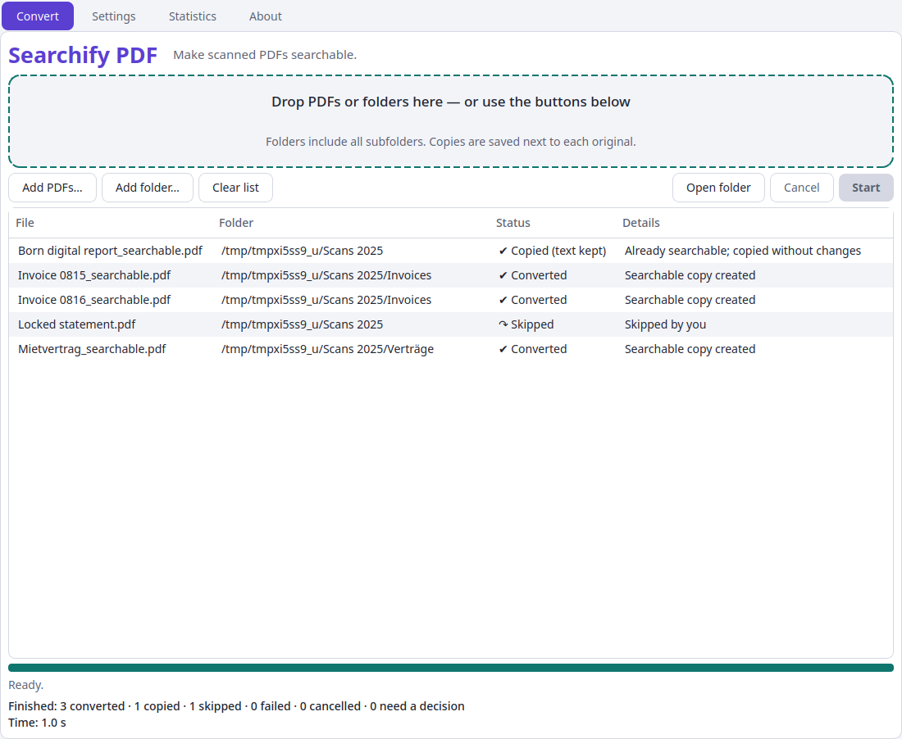
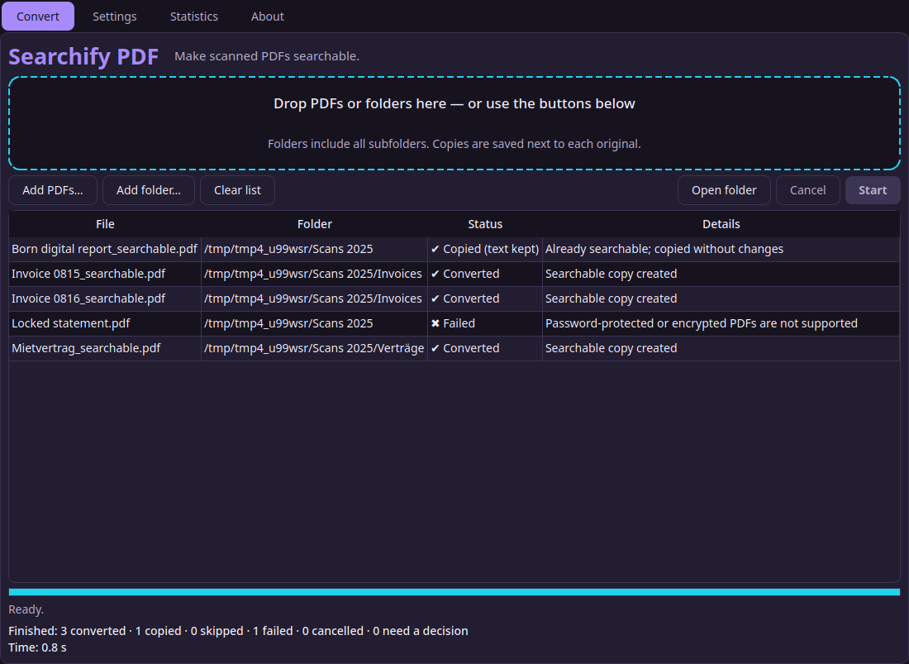
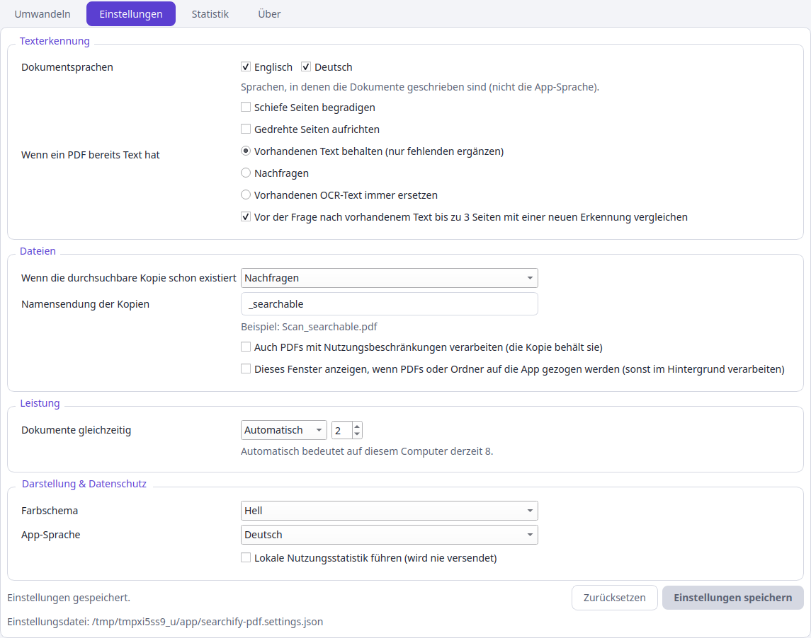

# Searchify PDF

[](https://github.com/marcelpetrick/SearchifyMyPDF/actions/workflows/ci.yml)
[](https://github.com/marcelpetrick/SearchifyMyPDF/actions/workflows/docker.yml)
[](https://github.com/marcelpetrick/SearchifyMyPDF/actions/workflows/release.yml)
[](https://github.com/marcelpetrick/SearchifyMyPDF/releases)
[](LICENSE)
[](https://www.python.org/)
[](https://doc.qt.io/qtforpython-6/)
[](https://ocrmypdf.readthedocs.io/)
[](scripts/check_coverage.py)
[-brightgreen.svg)](docs/mutation-baseline.md)

**Make scanned PDFs searchable.** Drop a PDF or a whole folder onto Searchify PDF and it
writes a searchable copy right next to each original — `Contracts/2025/Acme.pdf` becomes
`Contracts/2025/Acme_searchable.pdf`. Text recognition runs **locally** (OCRmyPDF +
Tesseract, English and German bundled); documents are never uploaded, originals are never
modified, and no Python or OCR installation is needed.

**Author: Marcel Petrick <mail@marcelpetrick.it>**

**License: GPLv3 or later. See [`LICENSE`](LICENSE).**

**Note: project is generated with AI.**



<details>
<summary>Dark theme and German settings</summary>




</details>

## Features

- **Drop and done:** drop PDFs/folders on the window or on the installed launcher; processing
  starts with your saved settings. Folders include all subfolders.
- **Copies beside originals** with a configurable suffix (default `_searchable`); no extra
  output folders; originals are only read. Generated copies are recognised and never
  re-processed (`_searchable_searchable.pdf` cannot happen).
- **Existing text:** keep it and only OCR image-only pages (default), always replace old
  OCR (`--redo-ocr`, never rasterizing), or ask — the question shows how well the old
  text agrees with a fresh recognition of up to 3 pages (good / doubtful / poor), and
  `--check-text` reports that for a whole folder without writing anything.
- **Existing copy:** overwrite, skip, or ask (default) — with "apply to the rest of this batch".
- **Protected PDFs:** asks for the password (or reads `--password-file`) and protects the
  copy with the same password and permissions; PDFs with usage restrictions ("no copying")
  are processed only when enabled in Settings, and the copy keeps the restrictions.
  Signed PDFs are rejected. See [`docs/adr/0011-protected-pdfs.md`](docs/adr/0011-protected-pdfs.md).
- **Safe publishing:** staged in the target folder, validated, then atomically published;
  failures, cancellation, full disks or crashes never damage the previous copy.
- **Parallel but bounded:** Automatic, one-after-another, or a fixed number of documents;
  one shared CPU budget; cancel kills OCR processes cleanly.
- **Portable settings** in `searchify-pdf.settings.json` next to the app; Save / Discard /
  Cancel on close; clear guidance when the folder is read-only, and an explicit opt-in to
  keep them in your user profile instead (*Store settings in my user profile*, or
  `--store-settings-in-profile`).
- **Light/dark themes, English/German UI**, keyboard shortcuts (Ctrl+O, Ctrl+Shift+O,
  Ctrl+Enter, Esc, Ctrl+S), status text never relies on colour alone.
- **Optional local statistics** (off by default): counts, configured languages, true
  medians; per-page time is shown as a labelled estimate.
- **About & licenses** offline, generated from the real build inputs.

## Install and use

Every [release](https://github.com/marcelpetrick/SearchifyMyPDF/releases) has executables
for 🐧 Linux x86-64, 🪟 Windows x86-64 and 🍎 macOS Apple silicon, plus `SHA256SUMS`.
Linux is the fully tested platform; Windows and macOS builds are **previews**: they are
smoke-tested on their own runners (version, licenses, GUI drop, OCR with the bundled
Tesseract) but not yet covered by the full test suite, and not code-signed.

### Linux

1. Download `searchify-pdf-<version>-linux-x86_64` from the
   [releases](https://github.com/marcelpetrick/SearchifyMyPDF/releases) (or the
   `searchify-pdf-linux-x86_64` artifact of the latest
   [Local Pipeline run](https://github.com/marcelpetrick/SearchifyMyPDF/actions/workflows/ci.yml))
   and verify it: `sha256sum -c SHA256SUMS`.
2. Put it into a folder you can write to (settings are stored beside it), then:

```bash
chmod +x searchify-pdf-*-linux-x86_64
./searchify-pdf-*-linux-x86_64                          # open the window
./searchify-pdf-*-linux-x86_64 --install-desktop-entry  # app-menu launcher: drop PDFs/folders on it
./searchify-pdf-*-linux-x86_64 ~/Scans                  # drop launch: open window and start
```

Requirements: x86-64 Linux with glibc ≥ 2.35 (Ubuntu 22.04+, Debian 12+, Fedora 36+, Arch/Manjaro)
and a normal desktop (X11 or Wayland).

### Windows and macOS (preview)

- **Windows 10/11:** run `searchify-pdf-<version>-windows-x86_64.exe`. It is not signed yet, so
  SmartScreen may warn: *More info → Run anyway*. A console window opens next to the app.
- **macOS 15+ (Apple silicon):** the executable is not notarized yet. In Terminal:
  `xattr -d com.apple.quarantine searchify-pdf-<version>-macos-arm64 && chmod +x searchify-pdf-<version>-macos-arm64 && ./searchify-pdf-<version>-macos-arm64`.
- Both accept the same command-line options as Linux (`--cli`, `--password-file`, …).

### Command line

```bash
searchify-pdf --cli ~/Scans                                  # headless, prompts on a terminal
searchify-pdf --cli --non-interactive --on-existing-output skip ~/Scans
searchify-pdf --cli --on-existing-text replace --languages eng --jobs 4 report.pdf
searchify-pdf --cli --password-file passwords.txt --process-restricted ~/Statements
searchify-pdf --licenses | --version | --help
```

Exit codes: `0` success · `1` failures or cancelled · `2` usage error · `3` a decision is
required ("Ask me" policy without a terminal — nothing was overwritten).

### Docker (headless CLI)

```bash
docker run --rm -v "$PWD:/data" ghcr.io/marcelpetrick/searchifymypdf:latest /data
docker run --rm -v "$PWD:/data" -v "$PWD/.searchify:/config" \
    ghcr.io/marcelpetrick/searchifymypdf:latest --on-existing-output overwrite /data
```

The image runs as an unprivileged user, needs no network, and reads optional settings
from `/config/searchify-pdf.settings.json`.

### Making copies findable

Desktop search tools index the embedded text. On Windows, PDF content indexing must be
enabled — see [`docs/windows-search.md`](docs/windows-search.md).

## Development

```bash
uv sync --locked && scripts/fetch_tessdata.sh   # needs uv, tesseract-ocr, Docker for packaging
uv run searchify-pdf                            # run from source
./localPipeline.sh                              # the full gate (same as CI)
./localPipeline.sh --fast                       # quick loop: format, lint, types, unit tests
./localPipeline.sh --mutation                   # additionally mutation testing
scripts/commit.sh patch "fix(scope): message"   # bump version → gate → commit → push
```

### Pipeline

`./localPipeline.sh` is the single gate; GitHub Actions only prepare a runner and call it.

| Stage | What |
| --- | --- |
| sync / tessdata | `uv sync --locked`; pinned, SHA-256-verified language data |
| format / lint / types / headers | Black, Ruff, mypy `--strict`, SPDX GPL headers |
| tests | pytest: unit + property tests, integration with **real OCR** (synthetic documents and a real-life corpus of public-domain / CC BY-SA scans 1929–1967, English and German — see `tests/fixtures/real/SOURCES.md`), a **recognition quality gate** against full ground truth (synthetic EN/DE incl. umlauts, real 1950 print; see [`docs/benchmarks.md`](docs/benchmarks.md#recognition-quality-plan-step-31)), UI tests offscreen (pytest-qt), fault/adversarial tests |
| coverage | statement **and** branch coverage checked separately, minimum 95 % (target 98 %) |
| wheel | sdist + wheel |
| binary / size | PyInstaller one-file executable built in Ubuntu 22.04 with Tesseract built from source; size budget 95 MB (currently ≈ 91 MB, see [`docs/benchmarks.md`](docs/benchmarks.md)) |
| e2e | packaged executable in clean, **offline** containers without Python/Tesseract: CLI, real-life corpus, portable settings, read-only app folder, `docker stop` cancel, terminal prompts, GUI drop launch, desktop launcher on a real X server |
| docker | builds the CLI image and runs its E2E tests offline (real-life corpus, `/config`, `docker stop`, non-root) |
| mutation (opt-in, weekly in CI) | mutmut on the core, minimum 95 % — see [`docs/mutation-baseline.md`](docs/mutation-baseline.md) |

Workflows: **Local Pipeline** (push/PR, Python 3.12 full + 3.13), **Docker** (build, smoke,
publish to GHCR), **Native builds** (Windows + macOS executables, smoke-tested), **Release** (tag `v*` →
full Linux pipeline + native builds → public GitHub release with all three platforms,
`SHA256SUMS`, inventories → download and verify the published assets), **Mutation** (weekly), **Dependencies** (pip-audit daily).

### Documentation

- [`VISION.md`](VISION.md) — product specification · [`PLAN.md`](PLAN.md) — plan, status, per-commit log
- [`AGENTS.md`](AGENTS.md) — working rules · [`CONTRIBUTING.md`](CONTRIBUTING.md) · [`SECURITY.md`](SECURITY.md)
- [`docs/architecture.md`](docs/architecture.md) — C4 views, flows and pipeline (Mermaid)
- [`docs/adr/`](docs/adr/) — architecture decision records
- [`docs/security-review.md`](docs/security-review.md), [`docs/compliance.md`](docs/compliance.md),
  [`docs/desktop-matrix.md`](docs/desktop-matrix.md), [`docs/benchmarks.md`](docs/benchmarks.md)
- [`scripts/README.md`](scripts/README.md) — every helper script

## Known limitations

- Windows and macOS builds are previews: smoke-tested only, unsigned, no Explorer/Finder
  drop integration yet (milestones M3 #10 and M4 #11).
- Digitally signed PDFs are rejected (reported, untouched); a copy would invalidate the signature.
- Desktop search tools may not index the text of password-protected copies.
- Pages that mix digital text with scanned regions keep their text unchanged in the default
  "keep existing text" mode.
- English and German language data are bundled; handwriting and very poor scans are not
  guaranteed to be recognised.
- Dropping onto the raw executable depends on the file manager — install the launcher.
