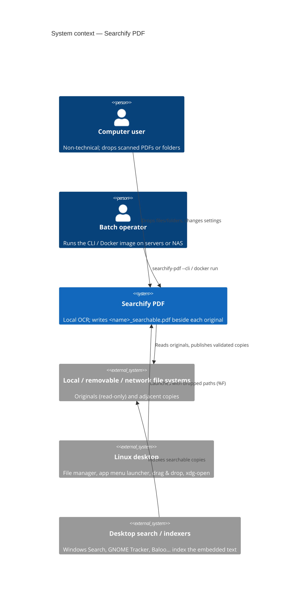
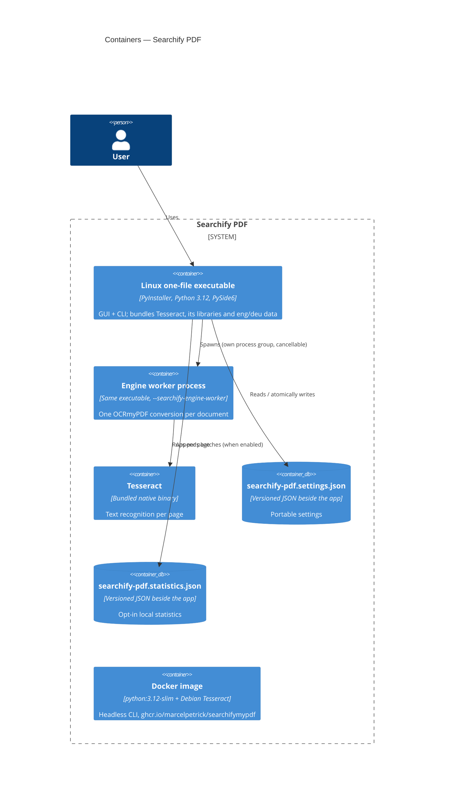
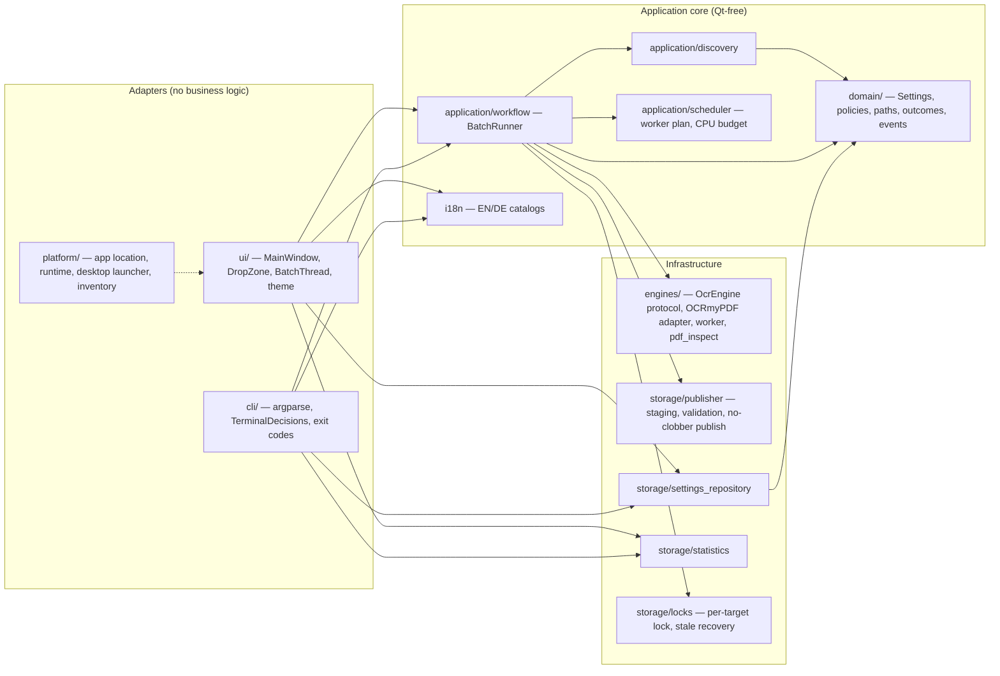
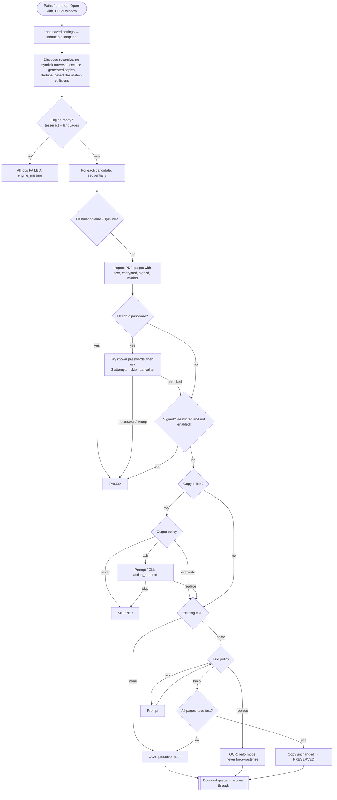
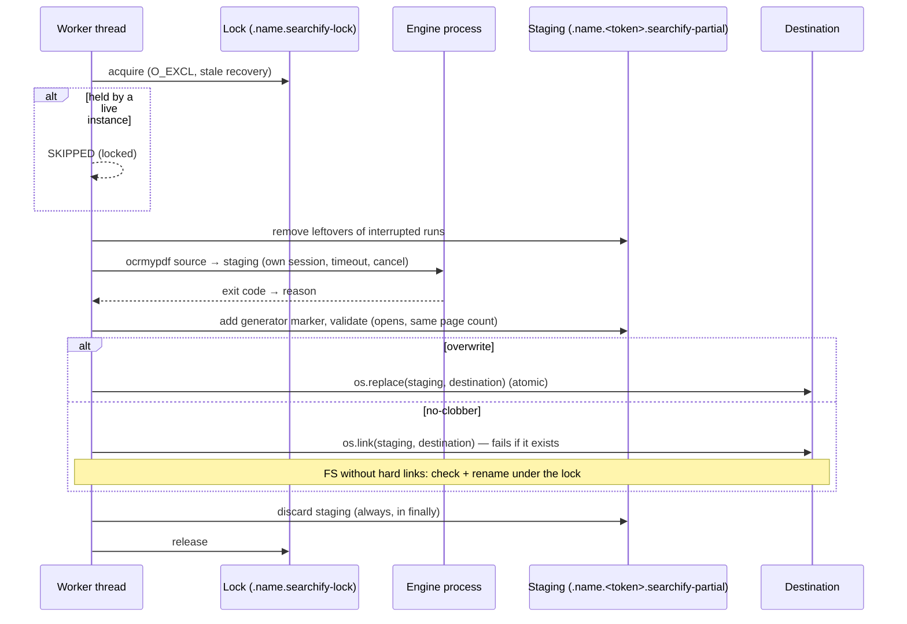
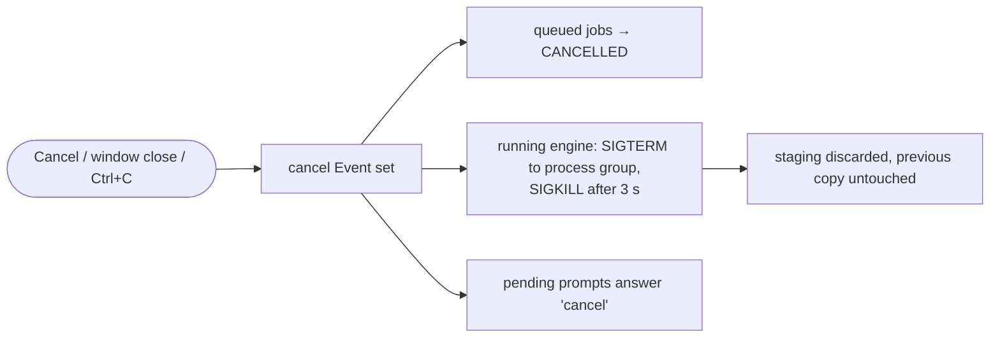
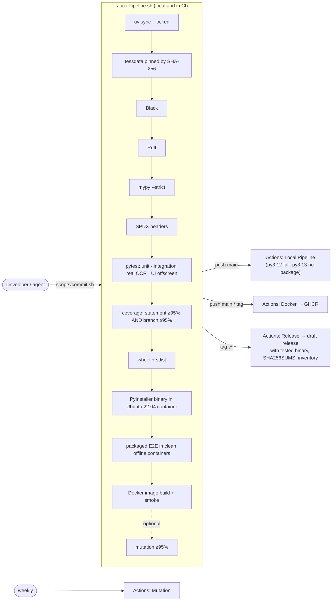

# Architecture

Searchify PDF is a local desktop application (plus headless CLI and Docker image) that
writes a searchable copy next to every scanned PDF. This page describes it with the
[C4 model](https://c4model.com/) (context → containers → components), the key runtime
flows, and the delivery pipeline. Decisions are recorded in [`docs/adr/`](adr/).

## C1 — System context

Nothing leaves the computer: no account, no telemetry, no upload. Optional statistics are
stored beside the application.

## C2 — Containers (deployable units)

## C3 — Components (inside the application)

Only `ui/` imports Qt. The engine is reached through the small `OcrEngine` protocol
(`capabilities`, `readiness_problem`, `run`), so another engine can be added without
touching UI or workflow.

## Key flows

### Drop launch / Start

### Publication of one job

### Cancellation

## Delivery pipeline

All workflows pin actions to commit SHAs, run with read-only permissions by default and
grant `contents: write` / `packages: write` only to the publishing jobs.
